  

  
  
  
  

  

> [!NOTE]
> From my early days as an intern building React front-ends to engineering enterprise-level back-end systems today — always with a focus on clean code and performance.

### `> ls ./stack`

  
   
  
  
  
  
  

### `> ls ./projects`

| Program | What it does | Stack |
|---|---|---|
| [`clone-tabnews`](https://github.com/ojoaobr/clone-tabnews) | Implementation of [TabNews](https://www.tabnews.com.br/), built during the [curso.dev](https://curso.dev/) course | `JavaScript` |
| [`test-framework`](https://github.com/ojoaobr/test-framework) | React project developed for an internship program | `React` `JavaScript` |
| [`Pedra_Papel_Tesoura`](https://github.com/ojoaobr/Pedra_Papel_Tesoura) | Rock-paper-scissors minigame | `Python` |

### `> ./stats --live`

  

  

<code>Knock, knock, recruiter... let's connect. 🐇</code>

