  <picture>
    <source media="(max-width: 600px)" srcset="https://github.com/ojoaobr/ojoaobr/raw/main/assets/header-mobile.svg"/>
    
  </picture>

  
  
  

  <picture>
    <source media="(max-width: 600px)" srcset="https://github.com/ojoaobr/ojoaobr/raw/main/assets/terminal-mobile.svg"/>
    
  </picture>

> [!NOTE]
> From my early days as an intern building React front-ends to engineering enterprise-level back-end systems today — always with a focus on clean code and performance.

### `> ls ./stack`

  

<code>Knock, knock... let's connect 🐇</code>

